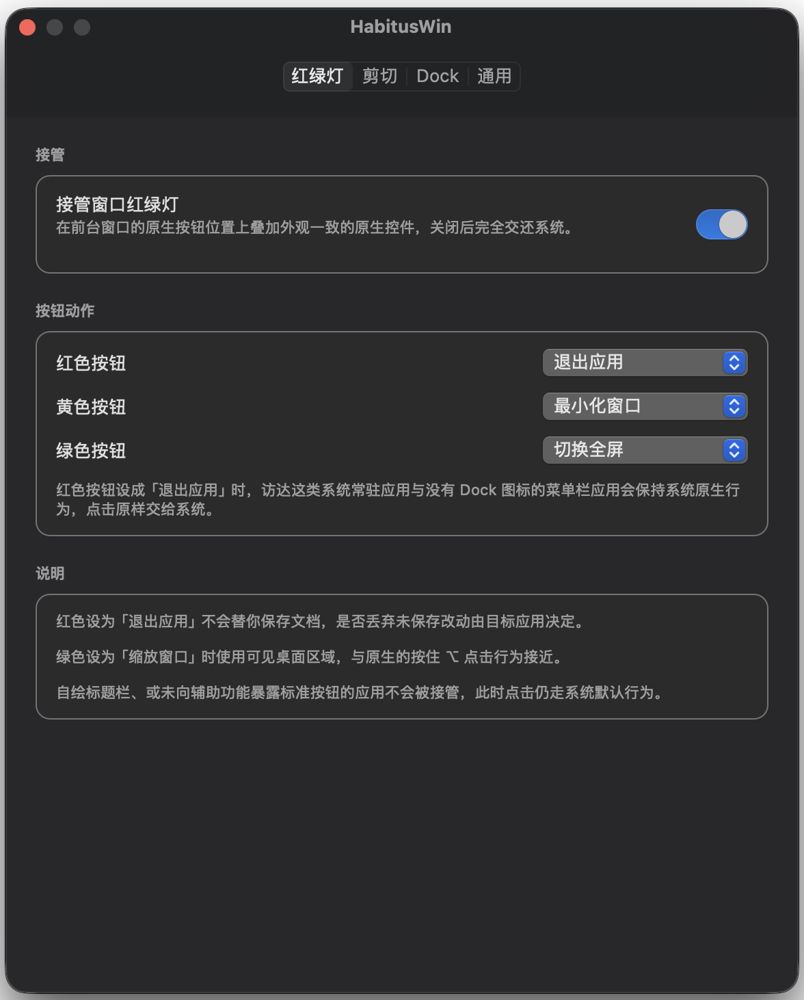

# HabitusWin

A small macOS menu bar utility that fills three gaps the system leaves open:

1. Remap the window traffic lights. Defaults match the system exactly (close / minimize / full screen), each one can be reassigned to quit, hide, or zoom.
2. A real ⌘X cut in Finder, with a paper-snip sound.
3. Click the Dock icon of the app you are already using to collapse and expand it.

No overlays are drawn, no code is injected, and nothing leaves your machine. All three features rely on the Accessibility permission, which is granted once.

Requires macOS 13 or later. Download the latest DMG from [Releases](../../releases).

<p align="center">
  
</p>

---

macOS 菜单栏常驻小工具，把三件系统不提供的操作补齐：

1. 窗口红绿灯可重映射。默认与系统一致（关窗口 / 最小化 / 全屏），可分别改成退出应用、隐藏应用、缩放窗口等。
2. Finder 真正的 ⌘X 剪切，剪切时播放音效。
3. 再次点击已在前台应用的 Dock 图标，在收起与展开之间切换。
4. 开机自动启动，走 macOS 13 的 SMAppService，条目登记在系统登录项里。
4. 开机自动启动，走 macOS 13 的 SMAppService，条目登记在系统登录项里。

## 下载

从 [Releases](../../releases) 下载最新的 `HabitusWin-x.y.z.dmg`。应用未做 Apple 公证，首次打开需要在「系统设置 → 隐私与安全性」点「仍要打开」，只做一次。

## 构建与运行

```bash
cd HabitusWin
./build.sh          # 产出 dist/HabitusWin.app，通用二进制
open dist/HabitusWin.app
```

发布包 `dist/HabitusWin-x.y.z.dmg` 内含 `安装.command`。它做三件手工安装容易漏的事：
复制到 /Applications、用 `lsregister -f -R -trusted` 注册到 LaunchServices、重启 Dock 刷新启动台缓存。
少了最后两步，启动台会看不到应用或者显示成通用图标，直到手动启动一次。

首次启动三个功能全部关闭，系统行为与安装前完全一致。需要哪个功能就在设置里打开对应开关。

红绿灯的默认动作与系统原生完全一致：红关闭窗口、黄最小化窗口、绿切换全屏。
只有你主动改动的那一项才会与系统不同。

授权顺序很重要：先开开关，系统才会弹出授权请求，点「打开系统设置」再勾选 HabitusWin。
应用没有主动请求过之前不会出现在辅助功能列表里，直接去系统设置找不到。
授予后 1 到 2 秒内自动生效，不需要重启。

菜单栏图标左键打开设置窗口，右键弹出开关菜单。

## 授权排障

「通用」页内置诊断，显示运行位置、AX 接口自检结果、签名类型。

| 现象 | 处理 |
|---|---|
| 列表里没有 HabitusWin | 先在应用里打开任意功能开关触发请求，或点「请求授权」 |
| 勾选后立刻跳回 | 点「清理旧授权记录」（tccutil reset），再重新请求 |
| 授予了但功能不生效 | 看诊断的 AX 接口自检；仍显示禁用说明系统记录的是另一个路径 |
| 运行位置不在 /Applications | 从 DMG 或下载目录直接运行会把授权记在临时路径，移到 /Applications 后重来 |

本版本为 ad-hoc 自签名，没有 Team ID，系统按 cdhash 记忆授权，替换应用后旧授权会失效。
正式分发应换成 Developer ID 签名，授权即可跨版本保留。

## 实现要点

### 红绿灯接管（v0.1.2 起改为事件拦截）

不注入进程、不改系统文件、不需要关闭 SIP。

- 用辅助功能 API 读取前台窗口的 `AXCloseButton` / `AXMinimizeButton` / `AXFullScreenButton` 坐标，缓存并做便宜的几何前置判断。
- 只有点击落在窗口左上角按钮区时，才做一次 `AXUIElementCopyElementAtPosition` 命中测试，确认 subrole 是这三个按钮之一。
- 确认后吞掉这次 mouseDown 与其后的 mouseUp，直接执行映射动作。

不再绘制覆盖层。旧方案用一个独立透明面板悬浮在原按钮上，面板与系统窗口属于两个不同的渲染对象，拖动窗口时必然不同步，就会出现残影。事件拦截没有可渲染的残留物，从根上消除该问题。

代价是被吞掉的那一次点击没有按下态凹陷；悬停时系统仍然正常显示叉、横线和三角。

退出只发一次合成 ⌘Q，不加重试、不发信号、不清理进程树。应用还开着其它窗口时只关当前窗口，避免一颗按钮带走全部工作；只剩最后一个窗口才发 ⌘Q，剩下的事交给应用自己的退出流程。

部分应用无法被强制退出，或退出较慢，这由应用自身的退出流程决定。例如退出时要等远程磁盘卸载、同步任务收尾的应用，从收到请求到真正结束可能隔着几十秒，期间 Dock 上的运行指示会一直亮着。

### ⌘X 剪切（参考 Supercharge 的 Command X）

只在 Finder 前台时处理键盘事件：

1. 拦截 ⌘X，吞掉事件，改用合成的 ⌘C 让 Finder 自己把选中项写入剪贴板。
2. 记录当时的 `changeCount` 作为剪切标记，播放音效。
3. 用户按 ⌘V 时，若剪贴板未被改写（changeCount 一致）则吞掉事件，改发 ⌘⌥V。
4. 移动由 Finder 自己完成，跨卷、同名冲突、权限提示、进度条全部沿用系统行为。

复制别的内容后 changeCount 变化，剪切标记自动失效。重命名文件时按 ⌘X 检测到焦点在文本框，直接放行文本剪切。

剪切音效 `Resources/Snip.wav` 由 `Tools/MakeSnipSound.py` 合成，两段带通噪声加指数衰减模拟刀刃咬合，仓库内可复现，无第三方素材。

### Dock 再次点击

v0.1.2 前用 `NSWorkspace.didActivateApplicationNotification` 判断，但 macOS 26 之后对已经处于前台的应用再次点击 Dock 图标，系统往往不再发这条通知，功能因此完全失效。

现在改为直接在点击事件里判断：命中指针位置，确认元素属于 Dock 进程，向上找到 `AXApplicationDockItem`，用标题或 AXURL 比对当前前台应用。命中则吞掉点击并执行动作。

同一颗图标要在收起与展开之间来回切换，方向只由真实窗口的 AX 最小化状态决定。
这里踩过两个坑。第一，访达把桌面作为一个 `AXScrollArea / AXDesktop` 塞进 `AXWindows`，它永远不可最小化，用「全部窗口是否都最小化」判断会永远为假，只能单向收起。所以判断前先过滤桌面窗口。第二，实测访达窗口最小化后 `CGWindowList` 仍把它算作在屏，用窗口服务器统计可见窗口同样不可靠，因此完全不用它。

访达、以及没有 Dock 图标的常驻应用，在红色按钮设为退出时会被跳过，点击原样交给系统。

三个功能共用一个 `CGEventTap`（keyDown + leftMouseDown + leftMouseUp），全部关闭时立即拆除，空闲不产生唤醒。

## 资源占用

- 空闲 CPU 0%，全部由通知与事件驱动，无轮询。
- 常驻内存实测约 45 MB（未授予辅助功能权限时）。

## 已知限制

- 自绘标题栏、或未向辅助功能暴露标准窗口按钮的应用不会被接管，点击仍走系统默认行为。
- 覆盖层会遮住绿色按钮的原生悬停分屏菜单，这是接管的必然代价。
- 全屏窗口不支持：既不显示覆盖层，也无法从 Dock 点击最小化。
- 「缩放窗口」使用当前屏幕的可见区域并记住原尺寸，再次点击还原；它不是 AppKit 的 optimal-size 算法。
- 系统每个大版本都可能调整按钮几何与 AX 行为，升级后需要回归一轮。
- 本机构建为 ad-hoc 签名，重新构建后系统可能重新要求授权。正式分发应使用 Developer ID 签名并公证。
- 上架 App Store 需要开启沙盒，而沙盒内无法使用辅助功能控制其它应用，因此这类工具只能直接分发。

## 目录结构

```
Sources/HabitusWin/
  main.swift                  启动入口
  AppDelegate.swift           模块装配
  AppSettings.swift           设置模型与持久化
  Permissions.swift           辅助功能授权
  AX.swift                    AX 读写封装与坐标换算
  WindowActions.swift         退出/隐藏/最小化/缩放/全屏
  TrafficLightModule.swift    窗口跟踪、遮挡判定、覆盖层同步
  TrafficLightOverlay.swift   覆盖面板与按钮绘制
  CutPasteModule.swift        Finder 剪切
  DockClickModule.swift       Dock 再次点击
  SoundPlayer.swift           音效
  SettingsWindow.swift        原生设置界面
  StatusItemController.swift  菜单栏图标
  SelfTest.swift              离屏渲染自检（--selftest）
```

调试用：`.build/release/HabitusWin --selftest` 会把四个设置页与红绿灯按钮条渲染到 `/tmp`，用于在没有截图权限的环境里检查界面。
`--settings` 让应用启动时直接打开设置窗口。
